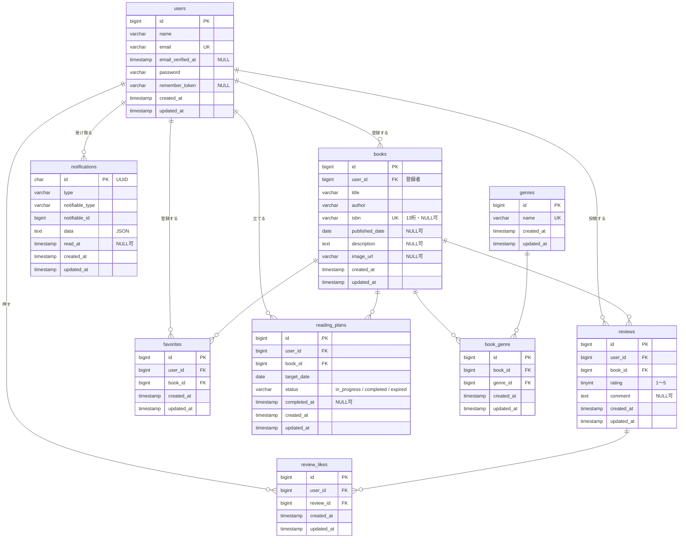

# BookShelf 書籍レビューアプリ

## 概要

読んだ本を登録し、評価とレビューを共有できる書籍レビューアプリです（COACHTECH 模擬案件。基本機能と応用機能を実装）。

### 実装した機能

基本機能

- 会員登録・ログイン・ログアウト（Laravel Fortify）
- 書籍の一覧（10件/ページ）・詳細・登録・編集・削除（編集・削除は登録者本人のみ）
- ジャンルの一覧（書籍数つき）・詳細・登録・編集・削除
- レビューの投稿・編集・削除（1冊につき1人1件。編集・削除は投稿者本人のみ）
- レビューへのいいね、書籍のお気に入り登録と一覧
- ランキング（レビュー平均評価 TOP10）
- 公開API（書籍の一覧・詳細・登録・更新・削除）

応用機能

- 書籍一覧のキーワード検索・ジャンル絞り込み・並び替え（条件はページ送りに引き継ぐ）
- 書籍登録画面の ISBN 検索（Google Books API から書名・著者などを入力）
- マイ読書レポート（`/reports`）
- 読書計画の一覧・作成・期日変更・読了・削除（`/reading-plans`）
- 通知一覧と既読化（`/notifications`）、日次バッチによる期日リマインダーと期限切れへの自動更新
- 公開APIの書き込み（POST/PUT/DELETE）に Laravel Sanctum のトークン認証

## 使用技術

- PHP 8.5（Laravel Sail のランタイム）
- Laravel 10
- MySQL 8.4
- Docker / Laravel Sail / phpMyAdmin
- Laravel Fortify（認証）、Laravel Sanctum（APIトークン認証）
- Vite / Tailwind CSS 3 / Alpine.js
- Google Books API（ISBN検索）
- PHPUnit 10 / Laravel Pint

## ER図



- 外部キーはすべて親の削除に合わせて削除（`cascadeOnDelete`）
- 一意制約：`book_genre(book_id, genre_id)`・`reviews(user_id, book_id)`・`favorites(user_id, book_id)`・`review_likes(user_id, review_id)`
- `notifications` は Laravel 標準の通知テーブル（多態の関連のため外部キー制約なし）
- Laravel 標準の `password_reset_tokens`・`failed_jobs`・`personal_access_tokens` は省略

## 環境構築手順

COACHTECH の「環境構築手順」で作った環境で動きます。このリポジトリを使う場合は、次の手順で再現できます。

1. リポジトリを取得する

    ```bash
    git clone https://github.com/hogasuke/bookshelf-app.git
    cd bookshelf-app
    ```

2. PHP の依存パッケージを入れる（ローカルに PHP が無くても Docker で実行できます）

    ```bash
    docker run --rm -u "$(id -u):$(id -g)" -v "$(pwd):/var/www/html" -w /var/www/html -e COMPOSER_CACHE_DIR=/tmp/composer_cache laravelsail/php82-composer:latest composer install --ignore-platform-reqs
    ```

3. `.env` を作る（DB 接続は学校指定の値が入っています）

    ```bash
    cp .env.example .env
    ```

    ```
    DB_CONNECTION=mysql
    DB_HOST=mysql
    DB_PORT=3306
    DB_DATABASE=laravel
    DB_USERNAME=sail
    DB_PASSWORD=password
    ```

4. Sail を起動する（phpMyAdmin も `compose.yaml` に追加済み）

    ```bash
    ./vendor/bin/sail up -d
    ```

    以降は `sail` のエイリアス（`alias sail='[ -f sail ] && bash sail || bash vendor/bin/sail'`）を設定した前提で書きます。

5. アプリケーションキーを作る

    ```bash
    sail artisan key:generate
    ```

6. テーブルを作り、初期データを入れる

    ```bash
    sail artisan migrate --seed
    ```

    作り直す時は `sail artisan migrate:fresh --seed`。

7. フロントエンドを用意する（応用版の Blade は `resources/` に取り込み済み）

    ```bash
    sail npm install
    sail npm run dev
    ```

    開発サーバーを立ち上げずに確認する場合は `sail npm run build`。

### ログイン用の初期ユーザー

Seeder で次の5人が入ります。パスワードはすべて `password` です。

| 名前 | メールアドレス |
| --- | --- |
| 山田太郎 | yamada@example.com |
| 鈴木花子 | suzuki@example.com |
| 田中一郎 | tanaka@example.com |
| 佐藤美咲 | sato@example.com |
| 高橋健太 | takahashi@example.com |

### 任意の設定

- ISBN検索：`.env` の `GOOGLE_BOOKS_API_KEY` は空でも動きます（キー無しで Google Books API を呼びます）。回数が多い時だけ設定してください。
- 日次バッチ：`reading-plans:process` を毎日 9:00 に実行するよう Schedule に登録しています。動かすには OS の cron から `sail artisan schedule:run` を毎分呼びます。手で試す時は `sail artisan reading-plans:process`（`--date=YYYY-MM-DD` で日付を指定できます）。

### テストと整形

```bash
sail artisan test --coverage
sail bin pint --test
```

## APIエンドポイント一覧

ベースURLは `http://localhost/api/v1`。応答は JSON です。

| メソッド | パス | 概要 | 認証 |
| --- | --- | --- | --- |
| POST | /api/v1/tokens | APIトークンを発行する（`email`・`password`・`device_name` 任意）。1分に10回まで | 不要 |
| GET | /api/v1/books | 書籍一覧（`keyword`・`genre_id`・`per_page` で検索・絞り込み・件数指定、ページ分割） | 不要 |
| GET | /api/v1/books/{book} | 書籍詳細 | 不要 |
| POST | /api/v1/books | 書籍を登録する（登録者はトークンの持ち主。`user_id` は送らない） | 必要 |
| PUT | /api/v1/books/{book} | 書籍を更新する（登録者本人のみ） | 必要 |
| DELETE | /api/v1/books/{book} | 書籍を削除する（登録者本人のみ） | 必要 |

書き込み系は `POST /api/v1/tokens` で受け取ったトークンを `Authorization: Bearer <token>` で送ります。トークンが無い時は 401、登録者以外が更新・削除した時は 403 を返します。

```bash
curl -X POST http://localhost/api/v1/tokens \
  -H "Accept: application/json" \
  -d "email=yamada@example.com" -d "password=password"
```

## 開発環境URL

- アプリ：http://localhost
- phpMyAdmin：http://localhost:8080

## 作成者

大沢 敬一朗
